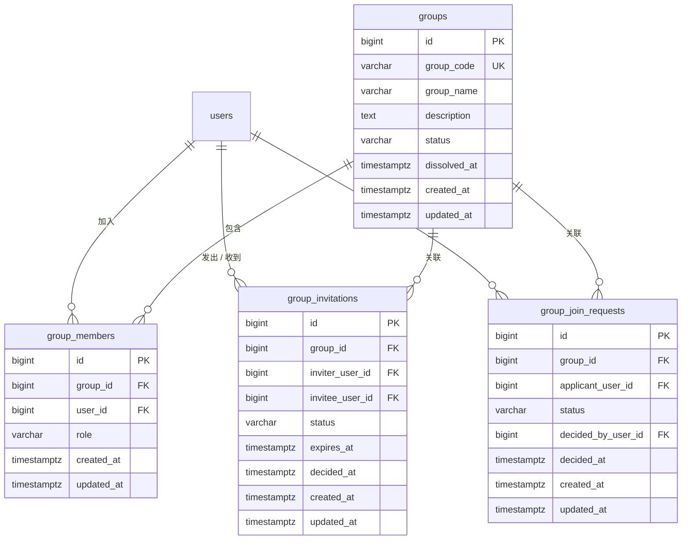

# StudyLab V1.1 项目文档

> 施工规格草案。最后更新 2026-11-13。

## 一、群组权限矩阵

**设计已确认 · ⛔ 待实现**

系统角色沿用 V1.0 的 `ADMIN` 和 `USER`。群组角色为 `OWNER`、`MANAGER` 和 `MEMBER`，按成员在目标群组中的角色判断权限。

| 角色 | 已确认的权限与边界 |
| --- | --- |
| `OWNER`（群组所有者） | 创建群组的用户自动成为首任 `OWNER`。可以修改本组名称与简介（`group_code` 不可改）。可以把本组任一 `MEMBER` 任命为 `MANAGER`。可以把所有权转让给本组任一成员，转让后退出，群组继续存在；**若未转让而直接退出群组，视为解散该群组**（接口上由 G5 承担，见下方 2026-11-13 条目），退出前须按第三节确认知识库的归档范围。 |
| `MANAGER`（群组管理者） | 由本组 `OWNER` 从本组任一 `MEMBER` 中任命。可以修改本组简介（名称与编码不可改）。可在本组邀请成员，移除成员时仅可移除本组群组角色为 `MEMBER` 的成员。本组资料的增删改查属于 `MANAGER` 的权限范围，V1.1 定义权限，相关接口随 V1.2 文档管理实现。 |
| `MEMBER`（群组成员） | 用户可以主动申请入组，获批后以 `MEMBER` 身份加入。成员可以主动退群，也可以查看本组知识库。复原的知识库按第三节的规则取得查看权限。 |
| `ADMIN`（系统管理员） | 系统运维身份：只负责系统级账号管理（如封锁异常账号）。**不加入任何群组、不担任任何群组角色、看不到任何群组内的知识库**；只有系统角色为 `USER` 的账号可以入群。 |

### 服务端校验

- 每次查看或操作群组资源时，服务端都按目标群组校验请求人的成员关系和群组角色。移除成员时，也要校验目标成员属于同一群组。
- 创建群组、入群、任命 `MANAGER` 和转让所有权时，服务端都要校验目标账号的系统角色：`ADMIN` 不属于任何群组，不得入群、不得担任任何群组角色。`MANAGER` 移除成员时，服务端须校验目标在本组的群组角色为 `MEMBER`，并仅移除本组成员关系。

**已确认 · `MANAGER` 任命资格**（2026-11-11）：任命资格只看群组角色，与系统角色无关——`OWNER` 可任命本组任一 `MEMBER` 为 `MANAGER`。原「系统角色为 `USER` 的成员不得获任」一句已删：`USER` 是唯一可入群的系统角色，该句会排除全部成员，无人可得任命。

**已确认 · 群组 `OWNER` 的账号被系统禁用**（2026-11-11）：采用**禁用时自动转让**。禁用事务内，服务端把该账号担任 `OWNER` 的群组所有权转给本组 `MANAGER`；没有 `MANAGER` 时转给最早加入的 `MEMBER`。`ADMIN` 不介入、不进群。

**已确认 · 群内无可转让对象**（2026-11-11）：若被禁用的 `OWNER` 所在群组除他之外已无任何成员，该群组自动解散，知识库按第三节默认**全选归档**（此时无人可确认归档范围，故取全选）。

**已确认 · `OWNER` 的存储方式**（2026-11-11）：`OWNER` 不单独占用 `groups` 表的列，而是 `group_members.role` 的一个取值，与 `MANAGER`、`MEMBER` 同表同列——判断「我在这个群是什么身份」只有一条查询路径，成员列表也不需要特判补人。列定义与索引留待数据库设计章。

**已确认 · 建组资格**（2026-11-11）：系统角色为 `USER` 的账号均可创建群组，创建事务内写入创建者的 `group_members.role = 'OWNER'`；`ADMIN` 不得创建。系统角色不变——`OWNER` 只是群组角色，不是新的系统角色。

**已确认 · `OWNER` 对 `MANAGER` 的处置**（2026-11-11）：`OWNER` 可以移除或降级本组任一 `MANAGER`（降级为 `MEMBER`）；`MANAGER` 只能移除群组角色为 `MEMBER` 的成员。

**已确认 · 邀请权**（2026-11-11）：只有本组 `OWNER` 与 `MANAGER` 有邀请权限（含生成邀请码）；`MEMBER` 无邀请权。第 2 节「有邀请权限的成员」即指这两个角色。

**已确认 · `MANAGER` 主动退群**（2026-11-11）：`MANAGER` 可以主动退群，退群即删除其成员行；`OWNER` 退群仍按「转让后退出，或视为解散」处理。

**已确认 · 群组名称与简介的修改权**（2026-11-13）：`group_name` 仅本组 `OWNER` 可改；`description` 为 `OWNER` 或 `MANAGER` 可改；`group_code` 创建后不可改（§4.3），请求体中出现该字段即拒绝。字段级权限见 §5.1 的 G4。

**已确认 · `OWNER` 调用「退群」接口的处理**（2026-11-13）：`OWNER` 不提供静默退群——`POST /groups/{group_id}/leave` 对 `OWNER` 返回 400，要求改用转让所有权（M5）或解散群组（G5）。理由是解散须先由 `OWNER` 确认知识库的归档范围（第三节），该确认只能随 G5 的请求体提交，不能由「退群」隐式触发。

**已确认 · 禁用 `OWNER` 时的调用方向**（2026-11-11）：`users` 模块在禁用事务内**单向调用** `groups` 模块的转让 / 解散逻辑（依赖方向 `app.modules.users → app.modules.groups`）。`groups` **不对外暴露**「把某人设为 `OWNER`」的公开入口，防止越权成为 `OWNER`；`groups` 也不 import `users.service`，只经 `users` 模型读账号，避免成环。

## 二、入组流程

**功能范围已确认 · ⛔ 待实现**

| 入组方式 | 流程 |
| --- | --- |
| 定向邀请 | 有邀请权限的成员向指定用户发出邀请，自发出起 24 小时内有效。受邀人可以接受或拒绝，发出方可以撤销待处理邀请。受邀人在有效期内接受后加入群组。 |
| 邀请码 | 有邀请权限的成员生成本组邀请码，并在生成时设定计划邀请的人数，作为成功入组人数上限。邀请码自生成起 24 小时内有效，支持撤销。登录用户提交有效且名额未用完的邀请码后加入对应群组。 |
| 主动申请 | 非成员可以通过申请链接或群组编码找到可申请的群组，登录后提交加入申请。申请人可以撤回待审批申请，由本组 `OWNER` 批准或拒绝。申请获批后，申请人加入群组。 |

- 定向邀请过期后失效。已拒绝、已撤销或已过期的邀请无法再用于入组，已撤销或已过期的邀请码也无法兑换。
- 入组时创建本组的 `MEMBER` 成员关系。同一用户在同一群组只保留一条成员关系。定向邀请的接受、邀请码的兑换和申请的批准都要校验当前状态，并与成员关系的写入在同一事务内完成。
- 同一用户可以对同一群组提交多条待审批申请。每条申请独立处理，批准时须检查申请人是否已是本组成员，避免重复创建成员关系。
- 邀请码每成功新增一名成员消耗一个名额，已有成员重复提交时不消耗名额。名额校验、扣减和成员关系写入在同一事务内完成，并发兑换也不得超过人数上限。
- 邀请和申请的处理都由服务端校验目标群组、操作者权限和当前状态。定向邀请的接受和拒绝仅由受邀人发起。

## 三、知识库归属与归档

**功能范围已确认 · ⛔ 待实现**

- 一个群组可以拥有多个知识库。使用中的知识库归属一个群组，只有该群组的 `OWNER` 和 `MANAGER` 可以创建知识库。普通知识库默认对本组全员可见。服务端按目标群组校验创建权限，并按群组归属过滤知识库查询。
- 解散群组时，默认选中已有知识库进行归档，由本组 `OWNER` 确认或调整归档范围。取消勾选的知识库随群组删除。归档保留日后复原所需的知识库信息和已有资料，并退出原群组的日常列表、检索和问答。
- 群组解散后，解散时担任该群组 `OWNER` 的用户可以预览和复原这些归档。该用户可以选择新建群组或任一自己当前担任 `OWNER` 的其他群组作为复原目标。
- 每份归档可成功复原一次。复原时沿用已有资料，查看权限从目标群组的 `OWNER` 开始授予。服务端在复原时校验归档归属和目标群组的 `OWNER` 身份，并在复原成功后移除归档记录。
- 复原后的知识库由目标群组的 `OWNER` 批准后，可向本组全员开放查看。全员开放前，`OWNER` 可以授权本组 `MANAGER` 查看，获授权的 `MANAGER` 可以为本组 `MEMBER` 开放该库的查看权限。
- `MANAGER` 被降级或失去该库的查看权限后，此前已授予本组 `MEMBER` 的查看权限继续有效。本组 `MANAGER` 可以提出变更或撤销其他 `MANAGER` 已授予的查看权限，经本组 `OWNER` 批准后生效。
- 服务端在列出知识库或读取其内容时，同时校验目标群组归属和该库的查看权限。

## 四、数据库设计

**表结构 ✅ 已完成**（2026-11-11 定稿；2026-11-12 四表迁移已应用并实测）。4.8 的清理逻辑属 Service 实现，尚未开始。

本节只定 V1.1 的四张群组表：`groups`、`group_members`、`group_invitations`、`group_join_requests`。邀请码、知识库、归档所需的表不在本节，随各自流程另行设计。

统一约定（与 V1.0 一致）：

- 主键 `BIGINT`，由 Alembic 生成 `BIGSERIAL`；外键同类型。
- 时间列一律 `TIMESTAMPTZ`（硬性约定 8），默认 `now()`。
- 枚举按成员名（`.name`）存 `VARCHAR(16)`，不用数据库原生 `ENUM`，不建 `CHECK`（硬性约定 7）。
- 表结构由 Alembic 迁移生成，不写 `schema.sql`（硬性约定 9）。
- 外键不设 `ON DELETE CASCADE`；解散群组时由 Service 在同一事务内显式清理（见 4.8）。

### 4.1 整体 ER 图

`users` 表定义见 `v1.0项目文档.md` 第 4.2 节，本节不重复。

### 4.2 状态枚举

**✅ 已完成**（2026-11-12）——四个枚举落于 `app/common/enums.py`，`ruff` 与断言实测通过。

| 枚举 | 取值 | 说明 |
| --- | --- | --- |
| `GroupStatus` | `ACTIVE` / `DISSOLVED` | `DISSOLVED` 表示群组已解散，行保留 |
| `GroupRole` | `OWNER` / `MANAGER` / `MEMBER` | 群组内角色；`OWNER` 只存在本枚举中 |
| `InvitationStatus` | `PENDING` / `ACCEPTED` / `REFUSED` / `CANCELLED` | 邀请状态；拒绝用 `REFUSED` |
| `JoinRequestStatus` | `PENDING` / `APPROVED` / `REJECTED` / `CANCELLED` | 申请状态；拒绝用 `REJECTED` |

两个「拒绝」分别沿用原版 DDL 的拼写：邀请是 `REFUSED`，加入申请是 `REJECTED`；撤销统一为 `CANCELLED`。V1.1 文档其余章节提到拒绝、撤销时，以本节取值为准。

### 4.3 `groups` 表

**✅ 已完成**（2026-11-12）：ORM 见 `app/modules/groups/models.py`；迁移 `b7c1e4d92f30` 已应用，`upgrade → downgrade → upgrade` 往返与库内逐列核对通过。

群组表。原版的 `owner_user_id` 列**不保留**：`OWNER` 的唯一来源是 `group_members.role`（第 1 节 2026-11-11 决定）。

| 字段 | 类型 | 约束 | 说明 |
| --- | --- | --- | --- |
| `id` | `BIGINT` | PK | 自增主键 |
| `group_code` | `VARCHAR(64)` | NOT NULL, UNIQUE | 对外展示与加入标识，创建后不可改 |
| `group_name` | `VARCHAR(128)` | NOT NULL | 群组名称 |
| `description` | `TEXT` | NOT NULL, DEFAULT `''` | 群组描述 |
| `status` | `VARCHAR(16)` | NOT NULL, DEFAULT `'ACTIVE'` | `ACTIVE` / `DISSOLVED` |
| `dissolved_at` | `TIMESTAMPTZ` | NULL | 解散时刻；`ACTIVE` 时为空 |
| `created_at` | `TIMESTAMPTZ` | NOT NULL, DEFAULT `now()` | 创建时间 |
| `updated_at` | `TIMESTAMPTZ` | NOT NULL, DEFAULT `now()` | 更新时间 |

约束：`uq_groups_group_code UNIQUE (group_code)`。

- 解散后行保留，`group_code` 仍占用唯一索引，编码不可复用。
- `dissolved_at` 与 `status` 由 Service 在同一事务内一起写；数据库不建 `CHECK` 约束。
- 群组编码的生成规则不改变列定义，`VARCHAR(64)` 足以容纳原版 `group-` + 32 位十六进制。

### 4.4 `group_members` 表

**✅ 已完成**（2026-11-12）：ORM 见 `app/modules/groups/models.py`；迁移 `b7c1e4d92f30` 已应用，`upgrade → downgrade → upgrade` 往返与库内逐列核对通过。

成员关系表。一行表示一个用户在一个群组中的一条成员关系。

| 字段 | 类型 | 约束 | 说明 |
| --- | --- | --- | --- |
| `id` | `BIGINT` | PK | 自增主键 |
| `group_id` | `BIGINT` | NOT NULL, FK → `groups.id` | 群组 ID |
| `user_id` | `BIGINT` | NOT NULL, FK → `users.id` | 用户 ID |
| `role` | `VARCHAR(16)` | NOT NULL, DEFAULT `'MEMBER'` | `OWNER` / `MANAGER` / `MEMBER` |
| `created_at` | `TIMESTAMPTZ` | NOT NULL, DEFAULT `now()` | 加入时间 |
| `updated_at` | `TIMESTAMPTZ` | NOT NULL, DEFAULT `now()` | 角色变更等最后修改时间 |

约束与索引：

- `uq_membership_group_user UNIQUE (group_id, user_id)`：同一用户在同一群组只保留一条成员关系。
- `fk_membership_group`、`fk_membership_user`。
- `idx_membership_user (user_id)`：查「我加入的群组」。
- `idx_membership_group_role (group_id, role)`：成员列表、按角色判断权限。

- 创建群组时，Service 在同一事务内插入创建者的 `role='OWNER'` 行；群组表不另存所有者。
- 所有权转让 = 更新目标成员为 `OWNER`，并删除原 `OWNER` 的成员行（原所有者转让后退出）。
- `ADMIN` 不得入群是 Service 校验，数据库不拦。

### 4.5 `group_invitations` 表

**✅ 已完成**（2026-11-12）：ORM 见 `app/modules/groups/models.py`；迁移 `b7c1e4d92f30` 已应用，`upgrade → downgrade → upgrade` 往返与库内逐列核对通过。

定向邀请表。有邀请权限的成员向指定用户发出，24 小时内有效。

| 字段 | 类型 | 约束 | 说明 |
| --- | --- | --- | --- |
| `id` | `BIGINT` | PK | 自增主键 |
| `group_id` | `BIGINT` | NOT NULL, FK → `groups.id` | 群组 ID |
| `inviter_user_id` | `BIGINT` | NOT NULL, FK → `users.id` | 邀请人用户 ID |
| `invitee_user_id` | `BIGINT` | NOT NULL, FK → `users.id` | 被邀请人用户 ID |
| `status` | `VARCHAR(16)` | NOT NULL, DEFAULT `'PENDING'` | `PENDING` / `ACCEPTED` / `REFUSED` / `CANCELLED` |
| `expires_at` | `TIMESTAMPTZ` | NOT NULL | 失效时刻 = 发出时刻 + 24 小时 |
| `decided_at` | `TIMESTAMPTZ` | NULL | 离开 `PENDING` 的时刻：接受、拒绝或撤销时写入 |
| `created_at` | `TIMESTAMPTZ` | NOT NULL, DEFAULT `now()` | 发出时间 |
| `updated_at` | `TIMESTAMPTZ` | NOT NULL, DEFAULT `now()` | 更新时间 |

约束与索引：

- `fk_invitation_group`、`fk_invitation_inviter`、`fk_invitation_invitee`。
- `idx_invitation_invitee_status (invitee_user_id, status)`：查我收到的待处理邀请。
- `idx_invitation_group_invitee (group_id, invitee_user_id)`：发出邀请前查重，以及接受时定位。

- 过期**不改写** `status`：行仍是 `PENDING`，由 Service 在接受到、拒绝、撤销或再次邀请时校验 `expires_at > now()`；不跑后台定时任务。
- 数据库**不建**「同一群组同一被邀请人只能有一条 `PENDING`」的部分唯一索引，由 Service 校验；并发下理论上可能出现两条待处理邀请，接受时以 `group_members` 的唯一约束兜底。
- 接受邀请时，状态改为 `ACCEPTED`，并在同一事务内插入 `role='MEMBER'` 的成员行。
- 群组解散时，本组 `PENDING` 邀请由 Service 删除（见 4.8）。

### 4.6 `group_join_requests` 表

**✅ 已完成**（2026-11-12）：ORM 见 `app/modules/groups/models.py`；迁移 `b7c1e4d92f30` 已应用，`upgrade → downgrade → upgrade` 往返与库内逐列核对通过。

加入申请表。用户通过群组编码或申请链接主动申请加入。

| 字段 | 类型 | 约束 | 说明 |
| --- | --- | --- | --- |
| `id` | `BIGINT` | PK | 自增主键 |
| `group_id` | `BIGINT` | NOT NULL, FK → `groups.id` | 群组 ID |
| `applicant_user_id` | `BIGINT` | NOT NULL, FK → `users.id` | 申请人用户 ID |
| `status` | `VARCHAR(16)` | NOT NULL, DEFAULT `'PENDING'` | `PENDING` / `APPROVED` / `REJECTED` / `CANCELLED` |
| `decided_by_user_id` | `BIGINT` | NULL, FK → `users.id` | 审批人；仅 `APPROVED` / `REJECTED` 时写入 |
| `decided_at` | `TIMESTAMPTZ` | NULL | 离开 `PENDING` 的时刻：批准、拒绝或撤回时写入 |
| `created_at` | `TIMESTAMPTZ` | NOT NULL, DEFAULT `now()` | 申请时间 |
| `updated_at` | `TIMESTAMPTZ` | NOT NULL, DEFAULT `now()` | 更新时间 |

约束与索引：

- `fk_join_request_group`、`fk_join_request_applicant`、`fk_join_request_decider`。
- `idx_join_request_group_status (group_id, status)`：查某群组的待处理申请。
- `idx_join_request_applicant (applicant_user_id)`：查某用户发起的申请。

- **不建**唯一约束：第 2 节已确认同一用户可对同一群组提交多条待审批申请，每条独立处理。
- 批准时状态改为 `APPROVED`，并在同一事务内检查申请人是否已是本组成员；不是成员才插入 `role='MEMBER'` 的成员行。
- 申请人撤回时状态改为 `CANCELLED`，`decided_by_user_id` 保持为空。
- 群组解散时，本组 `PENDING` 申请由 Service 删除（见 4.8）。

### 4.7 索引与约束汇总

| 表 | 约束 / 索引 | 用途 |
| --- | --- | --- |
| `groups` | `uq_groups_group_code` | 编码唯一；解散后仍占用 |
| `group_members` | `uq_membership_group_user` | 同一用户同一群组一条成员关系 |
| | `fk_membership_group` → `groups.id` | 成员关系归属群组 |
| | `fk_membership_user` → `users.id` | 成员关系归属用户 |
| | `idx_membership_user` | 我加入的群组 |
| | `idx_membership_group_role` | 成员列表、按角色判断权限 |
| `group_invitations` | `fk_invitation_group` → `groups.id` | 邀请归属群组 |
| | `fk_invitation_inviter` → `users.id` | 邀请人 |
| | `fk_invitation_invitee` → `users.id` | 被邀请人 |
| | `idx_invitation_invitee_status` | 我收到的邀请 |
| | `idx_invitation_group_invitee` | 发出前查重 |
| `group_join_requests` | `fk_join_request_group` → `groups.id` | 申请归属群组 |
| | `fk_join_request_applicant` → `users.id` | 申请人 |
| | `fk_join_request_decider` → `users.id` | 审批人（可空） |
| | `idx_join_request_group_status` | 群组待审批列表 |
| | `idx_join_request_applicant` | 我发起的申请 |

上表的约束名与索引名即 `app/modules/groups/models.py` 中的实际名；`alembic check` 对库比较无差集。

建表顺序：`groups` → `group_members` → `group_invitations` → `group_join_requests`，四张表放在同一迁移中。

### 4.8 解散群组的清理范围

主动解散，以及第 1 节「禁用 `OWNER` 且无可转让对象」导致的自动解散，走同一套清理：

1. `groups` 行保留：`status = 'DISSOLVED'`，写 `dissolved_at`。
2. 删除本组**全部** `group_members` 行。
3. 删除本组 `status = 'PENDING'` 的 `group_invitations` 行。
4. 删除本组 `status = 'PENDING'` 的 `group_join_requests` 行。
5. 已决的邀请与申请记录保留，供追溯；它们仍指向保留的 `groups` 行。

以上步骤与归档处理在同一事务内完成；知识库归档本身不在本节范围。

### 4.9 与原版 Argus 的差异

| 项目 | 原版 Argus | StudyLab V1.1 |
| --- | --- | --- |
| 建表方式 | 手写 `sql/schema.sql` | Alembic 迁移 |
| 时间类型 | `TIMESTAMP` | `TIMESTAMPTZ` |
| 成员表名 | `group_memberships` | `group_members` |
| 群组所有者 | `groups.owner_user_id` + `role='OWNER'` 双写 | 只存 `group_members.role` |
| 群组状态 | `ACTIVE` / `ARCHIVED`（`ARCHIVED` 未使用） | `ACTIVE` / `DISSOLVED` + `dissolved_at` |
| 邀请过期 | 无 `expires_at` | `expires_at`，默认 24 小时 |
| 邀请状态 | `PENDING` / `ACCEPTED` / `REFUSED` / `CANCELLED` | 同左 |
| 申请状态 | `PENDING` / `APPROVED` / `REJECTED` / `CANCELLED` | 同左 |
| 重复待审批申请 | Service 阻止 | 允许，多条独立处理 |
| 待处理邀请唯一性 | Service 校验 | Service 校验，数据库不加约束 |

---

## 五、API 设计

**设计已确认 · ⛔ 待实现**

统一挂在 `API_PREFIX`（`/api/v1`）下，下表路径省略该前缀；响应一律走 `ApiResponse`（`{success, data, message}`）。路径中的群组标识用 `group_id`（`BIGINT`），`group_code` 只作为发现与申请时的查询参数／入参。

路径风格为**混合式**：群组内资源嵌在 `/groups/{group_id}/` 下；跨群组的「我的」视图用顶层集合（`/invitations/received`、`/join-requests/mine`）。

路由文件：`app/modules/groups/router.py` 定义三个 `APIRouter`——`/groups`（`tags=["群组"]`）、`/invitations`（`tags=["群组邀请"]`）、`/join-requests`（`tags=["入组申请"]`），由 `app/api/router.py` 统一 `include_router`，与 V1.0 的 `users/router.py` 同时导出 `router` / `admin_router` 的做法一致。

### 5.1 群组

| 编号 | 方法 | 路径 | 成功码 | 权限与校验 |
| --- | --- | --- | --- | --- |
| G1 | `POST` | `/groups` | 201 | 系统角色须为 `USER`，`ADMIN` → 403。请求体：`group_code`（必填，`^[a-z0-9_-]{4,32}$`，唯一冲突 → 409）、`group_name`（必填）、`description`（可选，默认 `''`）。创建事务内同时写入创建者的 `group_members.role = 'OWNER'` |
| G2 | `GET` | `/groups/mine` | 200 | 只返回请求人当前所在的群组（`group_members` 中本人有行），按加入时间倒序 |
| G3 | `GET` | `/groups/{group_id}` | 200 | 本组成员；非成员与不存在一律 404，不区分 |
| G4 | `PATCH` | `/groups/{group_id}` | 200 | **字段级权限**：`group_name` 仅 `OWNER`；`description` 为 `OWNER` 或 `MANAGER`；`group_code` 出现即为 400（§4.3 不可改）。只校验请求体中**实际出现**的字段 |
| G5 | `POST` | `/groups/{group_id}/dissolve` | 200 | 本组 `OWNER`；按 §4.8 清理。归档范围入参（`archive_kb_ids`）待 B2 的归档表落地后补，当前不接受该字段 |
| G6 | `GET` | `/groups?code=xxx` | 200 | `code` 必填（缺省 → 422）；登录用户可查，非成员亦可。只返回 `group_id` / `group_code` / `group_name` / `description` / `member_count` / `is_member`，不返回成员明细 |

### 5.2 成员与角色

| 编号 | 方法 | 路径 | 成功码 | 权限与校验 |
| --- | --- | --- | --- | --- |
| M1 | `GET` | `/groups/{group_id}/members` | 200 | 本组成员 |
| M2 | `PATCH` | `/groups/{group_id}/members/{user_id}` | 200 | 本组 `OWNER`；请求体 `{role}` 只接受 `MANAGER` / `MEMBER`（不接受 `OWNER`——转让所有权限定走 M5）。目标须为本组成员 |
| M3 | `DELETE` | `/groups/{group_id}/members/{user_id}` | 200 | `OWNER` 可移除任一成员；`MANAGER` 仅可移除角色为 `MEMBER` 的成员，移除 `MANAGER` 或 `OWNER` → 403。目标须属于本组 |
| M4 | `POST` | `/groups/{group_id}/leave` | 200 | `MEMBER` / `MANAGER` 可调用，删除本人成员行；`OWNER` 调用 → 400（见 §1 2026-11-13 条目） |
| M5 | `POST` | `/groups/{group_id}/transfer-ownership` | 200 | 本组 `OWNER`；请求体 `{target_user_id}` 须为本组成员且不是本人。成功后原 `OWNER` 的角色改为 `MEMBER`，目标改为 `OWNER`（§1：转让后退出为可选行为，接口只做转让） |

### 5.3 定向邀请

| 编号 | 方法 | 路径 | 成功码 | 权限与校验 |
| --- | --- | --- | --- | --- |
| I1 | `POST` | `/groups/{group_id}/invitations` | 201 | `OWNER` / `MANAGER`；请求体 `{invitee_user_id}`。被邀请人须存在、系统角色为 `USER`、且非本组成员；同组同人已有 `PENDING` 邀请 → 409（§4.9 的唯一性由 Service 校验） |
| I2 | `GET` | `/groups/{group_id}/invitations?status=` | 200 | `OWNER` / `MANAGER`；`status` 可选，缺省返回全部 |
| I3 | `GET` | `/invitations/received` | 200 | 仅返回 `invitee_user_id` 为本人、状态 `PENDING` 且未过期的邀请 |
| I4 | `POST` | `/invitations/{invitation_id}/accept`、`/refuse` | 200 | 仅受邀人本人；状态须为 `PENDING` 且 `expires_at` 未到。`accept` 在同一事务内写入 `group_members`（`MEMBER`）并置 `ACCEPTED` / `decided_at` |
| I5 | `POST` | `/invitations/{invitation_id}/cancel` | 200 | 仅发出者本人（§2「发出方可以撤销」）；状态须为 `PENDING`，置 `CANCELLED` |

### 5.4 加入申请

| 编号 | 方法 | 路径 | 成功码 | 权限与校验 |
| --- | --- | --- | --- | --- |
| J1 | `POST` | `/groups/{group_id}/join-requests` | 201 | 登录用户且非本组成员；同一群组允许存在多条待审申请（§2、§4.9） |
| J2 | `GET` | `/groups/{group_id}/join-requests?status=PENDING` | 200 | 本组 `OWNER`；`status` 可选，缺省 `PENDING` |
| J3 | `GET` | `/join-requests/mine` | 200 | 仅返回 `applicant_user_id` 为本人 |
| J4 | `POST` | `/join-requests/{request_id}/cancel` | 200 | 仅申请人本人；状态须为 `PENDING`，置 `CANCELLED` |
| J5 | `POST` | `/join-requests/{request_id}/approve`、`/reject` | 200 | 本组 `OWNER`；状态须为 `PENDING`。`approve` 前须复查申请人是否已是成员（是则 409），通过则写入 `group_members`（`MEMBER`）、置 `APPROVED` / `decided_by_user_id` / `decided_at` |

### 5.5 状态码

| 码 | 语义 | 触发场景 |
| --- | --- | --- |
| 200 | 成功 | 查询、更新、角色变更、接受／拒绝、撤销、批准／拒绝、退群、转让 |
| 201 | 已创建 | G1 建组、I1 发邀请、J1 提交申请 |
| 400 | 请求本身不可接受 | `OWNER` 调用退群、`group_code` 出现在 G4 请求体 |
| 401 | 未登录 / token 无效 | 全部端点 |
| 403 | 角色不足 | `MEMBER` 发邀请、`MANAGER` 移除 `MANAGER`、非 `OWNER` 解散／任命／转让、`ADMIN` 建组或入群 |
| 404 | 不存在或不可见 | 群组、邀请、申请、成员关系不存在；非成员访问 G3 |
| 409 | 与资源当前状态冲突 | 编码已被占用、已是本组成员、同组同人已有待处理邀请、邀请/申请已非 `PENDING`、邀请已过期 |
| 422 | 请求参数校验失败 | 框架自动（`app/core/exceptions.py` 已有覆盖处理器） |

**新增 `ConflictException`（409）**，仅在 V1.1 的 groups 模块使用。判据是「请求与资源**当前状态**冲突，客户端刷新后重试可能成功」：编码已被占用、已是本组成员、同组同人已有待处理邀请、邀请/申请已非 `PENDING`、邀请已过期——一律抛它。

异常族由 V1.0 的 5 个类扩为 6 个（`AppException` + 5 个子类），处理器**无需改动**：`register_exception_handlers` 只注册 `AppException`，Starlette 按 MRO 命中，响应码取自 `exc.status_code`。

`OWNER` 调用退群、G4 请求体带 `group_code` 仍走 400 `BusinessException`——它们不是「状态冲突」，而是「该请求本就不被接受」。

V1.0 的 auth / users 模块**保持 400 不变**（用户名占用、邮箱占用、禁用自己），本次不改动。

### 5.6 尚未落地的两组

| 组 | 端点（设计方向） | 阻塞原因 |
| --- | --- | --- |
| 邀请码 | `POST /groups/{id}/invite-codes`（201）、`POST /invite-codes/{id}/cancel`（200）、`POST /invite-codes/redeem`（200） | **B1**：没有 `max_uses` / `used_count` 的表，§2 的「名额上限 + 并发不超员」无处落地 |
| 归档 | G5 的 `archive_kb_ids`、`GET /archives`、`POST /archives/{id}/restore` | **B2**：无归档表；且 §4.8 解散时删光 `group_members`，「解散时的 `OWNER`」事后无从查证 |

### 5.7 决策记录

| 日期 | 决定 |
| --- | --- |
| 2026-11-13 | 路径用混合式（群组内嵌套 + 顶层「我的」集合）；路径标识用 `group_id` |
| 2026-11-13 | 新增 `ConflictException`（409），仅 groups 模块用于状态冲突；V1.0 的 auth / users 保持 400 |
| 2026-11-13 | `group_code` 建组时由用户手填，格式 `^[a-z0-9_-]{4,32}$`，创建后不可改 |
| 2026-11-13 | 改名称仅 `OWNER`，改简介 `OWNER` + `MANAGER` |
| 2026-11-13 | 按编码发现群组返回编码、名称、简介、成员数、是否已是成员 |
| 2026-11-13 | `OWNER` 不提供静默退群，须走转让或解散 |
